<p align="center">
  
</p>

<p align="center">
  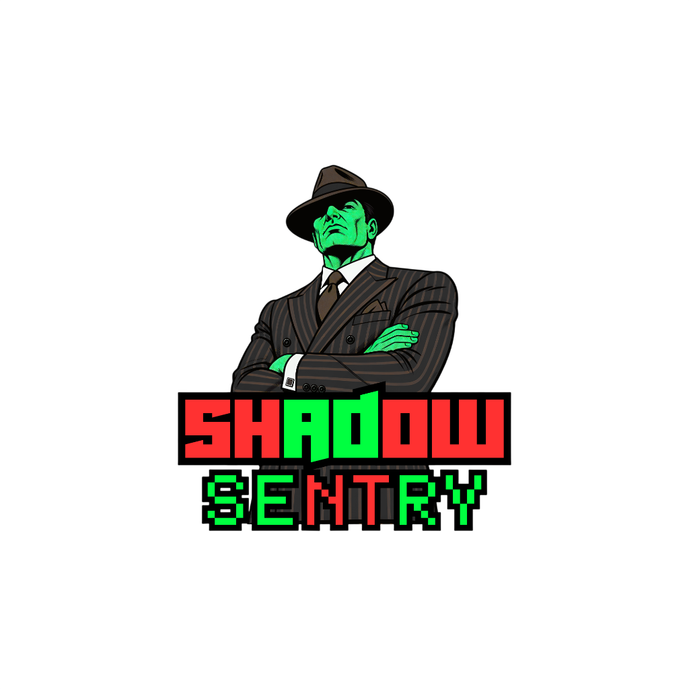
</p>

# SHADOWSENTRY

<p align="center">
  <a href="https://git.io/typing-svg">
    
  </a>
</p>

<p align="center">
  <a href="https://microsoft.com"></a>
  <a href="https://tauri.app"></a>
  <a href="LICENSE"></a>
  
  
</p>

**SHADOWSENTRY** is a native, local-first Windows 10/11 desktop network security and forensic intelligence platform. It provides wire-speed packet inspection, explainable threat detection, rogue gateway monitoring, and controlled honeypot deception directly on host network interfaces.

Engineered with a **strict offline-first, privacy-first posture**, SHADOWSENTRY requires zero cloud connections, collects zero telemetry, strips application payloads by default, and operates under least-privilege security boundaries.

---

## 📑 Table of Contents

- [⚡ Standalone Executable (.exe) Locations](#-standalone-executable-exe-locations)
- [🚀 Quick Launch Guide](#-quick-launch-guide)
- [🎯 Core Security Capabilities](#-core-security-capabilities)
- [🛡️ 10 Explainable Detection Rules](#️-10-explainable-detection-rules)
- [📦 Technology Stack & Real-Life Logos](#-technology-stack--real-life-logos)
- [🏗️ System Architecture](#️-system-architecture)
- [🖥️ Desktop Interface Tour (8 Panels)](#️-desktop-interface-tour-8-panels)
- [🧪 Automated Test Suite & Verification](#-automated-test-suite--verification)
- [🛠️ Build from Source](#️-build-from-source)
- [🔍 Forensic Honesty & Privacy Model](#-forensic-honesty--privacy-model)
- [📚 Documentation Directory](#-documentation-directory)

---

## ⚡ Standalone Executable (.exe) Locations

> [!IMPORTANT]
> **No Developer Setup Required:** You can run SHADOWSENTRY immediately by double-clicking the standalone binary. It contains embedded UI assets and requires no Node.js or Rust compiler on the target host.

| Artifact | Relative Path | Full Absolute Path | File Size | Description |
| :--- | :--- | :--- | :---: | :--- |
| **Primary Standalone Executable** | [`./ShadowSentry.exe`](file:///d:/projects%20and%20certificates/projects/apps/Shadow%20Sentry/ShadowSentry.exe) | `d:\projects and certificates\projects\apps\Shadow Sentry\ShadowSentry.exe` | ~228 MB | **Main Desktop Application.** Double-click to launch. |
| **WebView2 Dynamic Library** | [`./WebView2Loader.dll`](file:///d:/projects%20and%20certificates/projects/apps/Shadow%20Sentry/WebView2Loader.dll) | `d:\projects and certificates\projects\apps\Shadow Sentry\WebView2Loader.dll` | ~160 KB | Required companion library in the root folder. |
| **Cargo Debug Binary** | [`./src-tauri/target/debug/shadowsentry.exe`](file:///d:/projects%20and%20certificates/projects/apps/Shadow%20Sentry/src-tauri/target/debug/shadowsentry.exe) | `d:\projects and certificates\projects\apps\Shadow Sentry\src-tauri\target\debug\shadowsentry.exe` | ~228 MB | Native binary output produced by the Cargo build engine. |
| **Windows MSI Installer** | [`./src-tauri/target/debug/bundle/msi/ShadowSentry_0.1.0_x64_en-US.msi`](file:///d:/projects%20and%20certificates/projects/apps/Shadow%20Sentry/src-tauri/target/debug/bundle/msi/ShadowSentry_0.1.0_x64_en-US.msi) | `d:\projects and certificates\projects\apps\Shadow Sentry\src-tauri\target\debug\bundle\msi\ShadowSentry_0.1.0_x64_en-US.msi` | 96.64 MB | Self-contained Windows installer package. |

---

## 🚀 Quick Launch Guide

### 1. Launching the Desktop Application
* **Method 1 (File Explorer):** Double-click [`ShadowSentry.exe`](file:///d:/projects%20and%20certificates/projects/apps/Shadow%20Sentry/ShadowSentry.exe) in the root directory.
* **Method 2 (PowerShell):**
  ```powershell
  cd "d:\projects and certificates\projects\apps\Shadow Sentry"
  .\ShadowSentry.exe
  ```
* **Method 3 (via npm script):**
  ```powershell
  npm start
  ```

### 2. Packet Capture Mode Selection

| Mode | Privilege | Network Scope | How to Activate |
| :--- | :---: | :--- | :--- |
| **Mode 1: Windows Native Raw Sockets** | **Administrator** | Live IPv4, TCP, UDP, DNS (Zero driver dependencies) | Right-click [`ShadowSentry.exe`](file:///d:/projects%20and%20certificates/projects/apps/Shadow%20Sentry/ShadowSentry.exe) ➔ **"Run as administrator"**. |
| **Mode 2: Npcap Promiscuous Sniffer** | Standard / Admin | Full Layer-2 Ethernet, ARP cache anomalies, raw frames | Install [Npcap](https://npcap.com/#download) with *"WinPcap API-compatible Mode"* enabled. |
| **Mode 3: Lab Synthetic Mode** | Standard User | Realistic offline simulation (DNS DGA, port scans, gateway changes) | Launch normally without elevation; starts automatically if raw sockets are unavailable. |

> 📖 **Detailed Execution Manual:** Refer to [`HOW_TO_RUN.md`](file:///d:/projects%20and%20certificates/projects/apps/Shadow%20Sentry/HOW_TO_RUN.md) for network adapter configurations, firewall setup, and troubleshooting.

---

## 🎯 Core Security Capabilities

1. **Multi-Tier Packet Capture Engine**
   - Direct Windows Sockets 2 (`AF_INET, SOCK_RAW, IPPROTO_IP`) implementation for zero-install live sniffing.
   - Dynamic `wpcap.dll` runtime loader via `libloading` with zero crash risk if Npcap is absent.
   - Bounded ring buffers (1,000 packets max, 500 DNS queries max) with FIFO eviction to prevent memory growth.

2. **Zero-Panic Wire Parser**
   - Strict slice bounds checking on every protocol layer: Ethernet II, ARP, IPv4, IPv6, TCP, UDP, and DNS wire-format questions.
   - Shannon entropy math calculation on domain labels to detect algorithmically generated domains (DGA) and DNS tunneling.

3. **Opt-in Local Honeypot Deception Lab**
   - **HTTP Decoy (`:8088`):** Emulates web servers and catches reconnaissance probes for `/.env`, `/admin`, `/wp-login.php`.
   - **Administrative Portal Simulator (`:8443`):** Emulates internal router dashboards with simulated challenge-response authentication.
   - **SSH Banner Simulator (`:2222`):** Emulates OpenSSH banners and safely terminates client sockets upon handshake.
   - *Safeguards:* Bound to `127.0.0.1` by default, 5-second socket timeouts, 16 KB request body ceiling, and anti-pivot isolation.

4. **Forensics & Local Privacy Storage**
   - Embedded SQLite 3 with Write-Ahead Logging (WAL) for microsecond event insertion.
   - Sanitized CSV and JSON forensic export that strips internal OS paths and raw payload data.
   - One-click cryptographic-safe database purge with SQLite `VACUUM` to reclaim disk space.

5. **Tactical SOC Audio & Web Audio Synthesizer**
   - **Zero-Dependency Sound Generation:** Synthesizes audio cues entirely via native browser Web Audio API oscillators and gain envelopes with zero external MP3/WAV file downloads.
   - **Explainable Audio Telemetry:** Distinct sound cues for diagnostic boot sequence, critical dual-pulse threat alerts, honeypot radar pings, packet capture toggles, and UI interactions.
   - **Dedicated Controls & Audio Test Board:** One-click mute button in top navigation bar (`Volume2` / `VolumeX`) and full interactive testing soundboard inside Settings.

---

## 🛡️ 10 Explainable Detection Rules

<p align="center">
  
</p>

Unlike opaque machine learning models that generate unexplainable anomaly scores, every alert in SHADOWSENTRY is **100% deterministic, evidence-backed, and explainable**:

| Rule ID | Detection Name | Heuristic Trigger Conditions | Actionable Triage Recommendation |
| :--- | :--- | :--- | :--- |
| `RULE-01-PORT-SCAN` | Multi-Port Reconnaissance Scan | $\ge 15$ distinct target ports probed from a single source IP within 10 seconds. | Verify if source IP belongs to an authorized vulnerability scanner or isolated rogue host. |
| `RULE-02-BURST` | Unusual Connection Burst | Packet rate from source IP exceeds $5\times$ baseline threshold ($> 100$ pkts/sec). | Check for automated download scripts, sync utilities, or distributed denial attempts. |
| `RULE-03-CONN-FAILURES` | Repeated Connection Failures | $\ge 10$ TCP RST (Reset) packets received from destination within 15 seconds. | Investigate port knocking, firewall rejection, or misconfigured service endpoints. |
| `RULE-04-SUSP-DNS` | High-Entropy / DGA DNS Query | Shannon entropy $> 3.8$ on domain labels or domain query length $> 45$ characters. | Inspect client processes for malware C2 beaconing or DNS data exfiltration tunnels. |
| `RULE-05-GATEWAY-CHANGE` | Gateway Identity Change | Default gateway MAC address changes from previously verified baseline MAC. | Critical: Investigate potential ARP spoofing, rogue router injection, or Man-in-the-Middle. |
| `RULE-06-ARP-ANOMALY` | ARP Cache Conflict | Same IP address claimed by two distinct MAC addresses on the local subnet. | Inspect network segment for IP address conflict or active ARP poisoning tools (Ettercap/Cain). |
| `RULE-07-THREAT-INTEL` | Threat Intelligence Match | Outbound communication targeting known malicious C2 IP or botnet endpoint. | Isolate host from LAN; review active network sockets and running executable hashes. |
| `RULE-08-HONEYPOT-INTERACTION` | Honeypot Probing Activity | Unsolicited connection attempt targeting local decoy services (:8088, :8443, :2222). | Identify internal host conducting lateral movement or automated subnet reconnaissance. |
| `RULE-09-INBOUND-ANOMALY` | Unsolicited Admin Port Inbound | Inbound TCP SYN targeting sensitive ports: 445 (SMB), 3389 (RDP), 1433 (MSSQL), 23 (Telnet). | Block inbound port at host firewall; verify if client is authorized administrative jumper. |
| `RULE-10-CONFIG-CHANGE` | Monitoring State Alteration | Network interface link transition, IP change, or capture subsystem toggle. | Audit administrative access logs to verify if capture pause was an intentional user action. |

---

## 📦 Technology Stack & Real-Life Logos

> 📄 **Complete Package & Version Details:** See [`PACKAGES_NEEDED.md`](file:///d:/projects%20and%20certificates/projects/apps/Shadow%20Sentry/PACKAGES_NEEDED.md) for full compilation flags, crate features, and dependency documentation.

### 1. Host Runtimes & Compilers
| Logo | Technology | Role in SHADOWSENTRY |
| :---: | :--- | :--- |
|  | **Windows 10 / 11 (x64)** | Host operating system. Leverages Windows Sockets 2, IP Helper API, and Win32 tokens. |
|  | **Microsoft Edge WebView2** | Native desktop UI rendering container embedded in Tauri 2 window frames. |
|  | **Rust 1.75+ (MSVC)** | Native systems security core, zero-panic wire parser, and SQLite event pipeline. |
|  | **VS C++ Build Tools** | Linker (`link.exe`) and Windows SDK headers for the `x86_64-pc-windows-msvc` target. |
|  | **Node.js v18+ & npm** | Build tooling, TypeScript compiler execution, and Vite production asset bundling. |
|  | **Python 3.10+** | Automated test fixture generation and honeypot validation probe scripts. |
|  | **Npcap Driver** *(Optional)* | Promiscuous Layer-2 Ethernet capture and raw frame sniffing. |

### 2. Frontend Application Stack (Node.js / npm)
| Logo | Package | Purpose |
| :---: | :--- | :--- |
|  | **React 18** | Reactive desktop components, real-time packet rendering, and interactive timeline state. |
|  | **TypeScript 5.7** | Strict type safety across packet models, forensic filters, and IPC payloads. |
|  | **Vite 6** | Ultra-fast asset bundler that compiles HTML/JS into zero-gradient embedded UI assets. |
|  | **@tauri-apps/api** | Hardened type-safe IPC command bridge connecting React UI with Rust security core. |
|  | **Lucide React** | Precise, sharp technical iconography for network tables, threat indicators, and protocols. |

### 3. Backend Security Core (Rust / Cargo)
| Logo | Crate | Purpose |
| :---: | :--- | :--- |
|  | **`tauri` (v2)** | Window management, menu actions, tray integration, and scoped IPC commands. |
|  | **`tokio` (v1)** | Asynchronous multi-threaded runtime powering packet sniffing and honeypot listeners. |
|  | **`rusqlite` (v0.31)** | Bundled C SQLite 3 engine with WAL mode for zero-latency local persistent storage. |
|  | **`windows-sys`** | Low-level WinSock 2 (`SOCK_RAW`) and IP Helper (`GetIpNetTable`) API bindings. |
|  | **`serde` & `serde_json`** | Zero-copy serialization of packet streams, alert evidence, and forensic queries. |
|  | **`libloading`** | Dynamic runtime loader that checks for `wpcap.dll` without binary crashes. |

---

## 🏗️ System Architecture

SHADOWSENTRY is divided into four strictly isolated layers to guarantee security and performance:

```
┌────────────────────────────────────────────────────────────────────────┐
│                        HARDENED REACT FRONTEND                         │
│  React 18 • TypeScript • Tailwind-Free CSS Tokens • Technical Dark UI  │
│  Live Packet Stream • Forensic Search • Threat Timeline • SVG Metrics  │
└───────────────────────────────────┬────────────────────────────────────┘
                                    │
                       Tauri 2 Scoped IPC Commands
               (Zero arbitrary shell, zero unrestricted fs)
                                    │
┌───────────────────────────────────▼────────────────────────────────────┐
│                          RUST SECURITY ENGINE                          │
│                                                                        │
│  ┌──────────────────────┐ ┌──────────────────────┐ ┌─────────────────┐ │
│  │   Capture Subsystem  │ │  Zero-Panic Parser   │ │Detection Engine │ │
│  │  - Npcap (wpcap.dll) │ │   - Ethernet / ARP   │ │ - 10 Rules      │ │
│  │  - Native Raw Socket │ │   - IPv4 / IPv6      │ │ - Port Scans    │ │
│  │  - Lab Synthetic Mode│ │   - TCP / UDP / DNS  │ │ - DGAs (Entropy)│ │
│  └──────────────────────┘ └──────────────────────┘ └─────────────────┘ │
│  ┌──────────────────────┐ ┌──────────────────────┐ ┌─────────────────┐ │
│  │  Honeypot Decoy Lab  │ │   Network Discovery  │ │ Local SQLite DB │ │
│  │  - HTTP Decoy (8088) │ │   - Win32 IP Helper  │ │ - WAL Mode      │ │
│  │  - Admin Port (8443) │ │   - Gateway Polling  │ │ - Sanitized Exp │ │
│  │  - SSH Banner (2222) │ │   - ARP Cache Table  │ │ - Fast Vacuum   │ │
│  └──────────────────────┘ └──────────────────────┘ └─────────────────┘ │
└───────────────────────────────────┬────────────────────────────────────┘
                                    │
┌───────────────────────────────────▼────────────────────────────────────┐
│                         WINDOWS HARDWARE & OS                          │
│   Network Adapters • WinSock 2 (Raw) • IP Helper API • Local NVMe/SSD  │
└────────────────────────────────────────────────────────────────────────┘
```

---

## 🖥️ Desktop Interface Tour (8 Panels & Interactive Guide)

SHADOWSENTRY provides eight technical investigation workspaces accessible via the left navigation sidebar, top status bar, or keyboard shortcuts.

### 1. Interactive Walkthrough & How to Use Guide (`How to Use` Button)
> An onboard 6-chapter interactive SOC tutorial with rich UI previews, capture mode comparisons, and direct tab navigation.
<p align="center">
  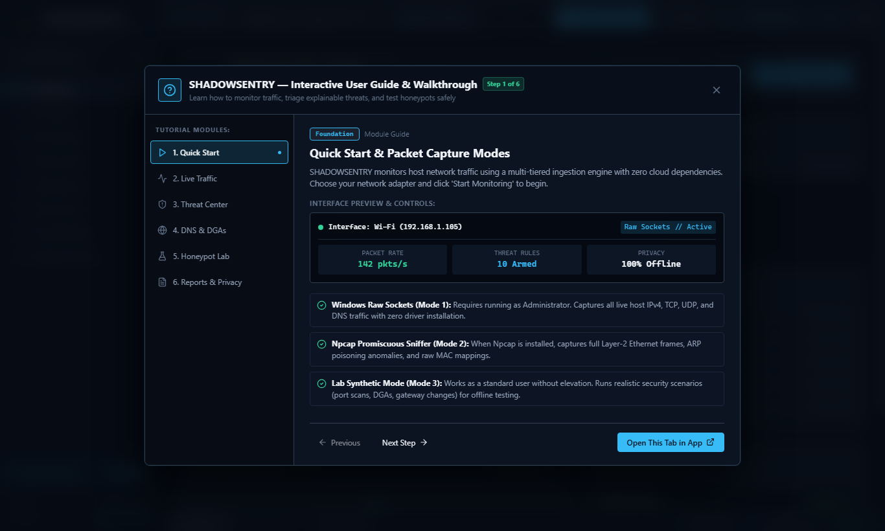
</p>

### 2. Sequential Subsystem Initialization & Smooth Splash Screen
> A 7-second diagnostic boot sequence with animated mascot, progressive driver ingestion (WinSock ➔ Npcap ➔ SQLite ➔ Heuristics ➔ Honeypot), and a butter-smooth 850ms cinematic cross-dissolve into the mission dashboard.
<p align="center">
  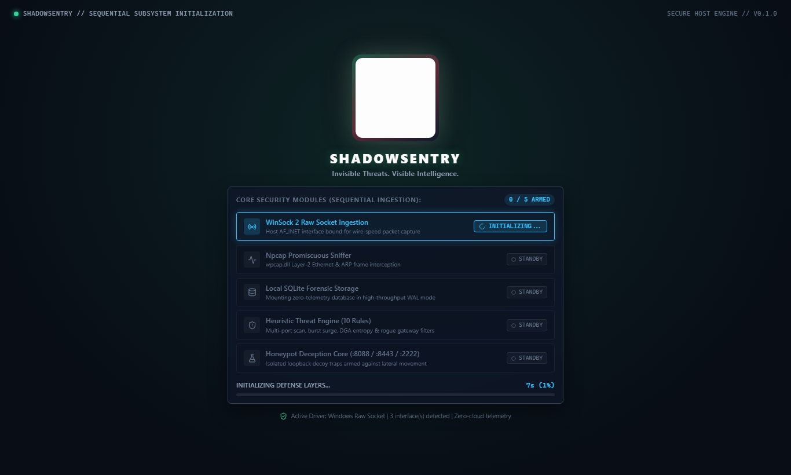
</p>

### 3. Mission Control Dashboard (`Ctrl + 1`)
> Real-time wire-speed bandwidth telemetry, protocol distribution graphs, active threat counter, recent explainable findings, and primary monitoring engine controls.
<p align="center">
  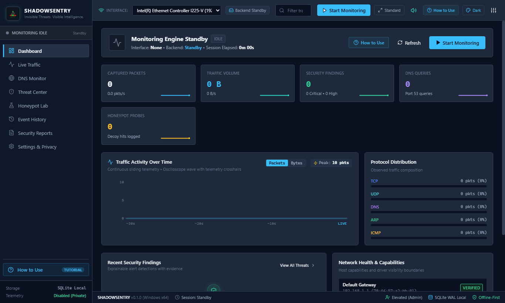
</p>

### 4. Wire-Speed Live Traffic Inspector (`Ctrl + 2`)
> High-throughput streaming packet inspector with protocol filters (TCP/UDP/ICMP/DNS), byte-level hex viewer, and sub-millisecond timeline tracking.
<p align="center">
  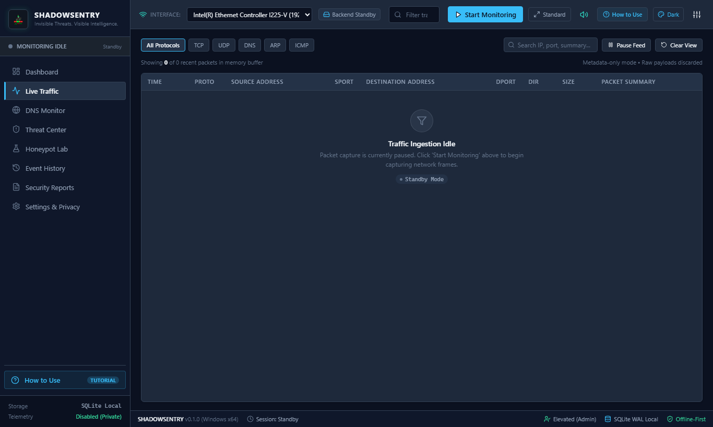
</p>

### 5. Explainable Threat Center — 10 Defense Rules (`Ctrl + 3`)
> Correlated detection engine highlighting port scans, SYN floods, ARP spoofing, rogue gateway shifts, and suspicious inbound connections with observed evidence and MITRE ATT&CK mapping.
<p align="center">
  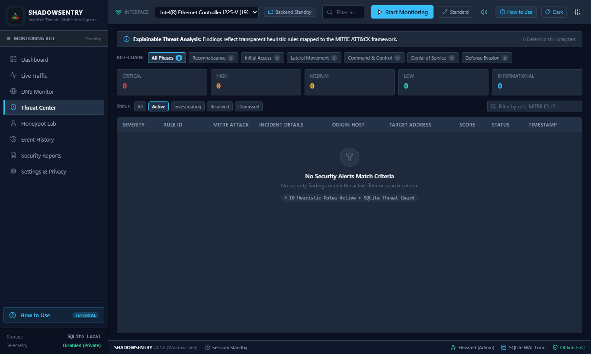
</p>

### 6. Shannon DNS Entropy & DGA Heuristics (`Ctrl + 4`)
> Continuous domain query analysis scoring character entropy (>3.80 bits/char) to isolate malware Command & Control (C2) beaconing and DNS tunneling.
<p align="center">
  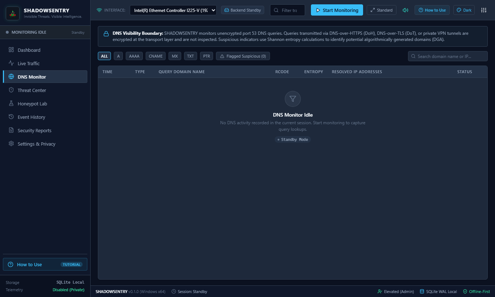
</p>

### 7. Opt-In Local Honeypot Deception Lab (`Ctrl + 5`)
> Three safe loopback decoy services (HTTP `:8088`, Admin Portal `:8443`, SSH Simulator `:2222`) equipped with 1-click test attack simulation and real-time probe logging.
<p align="center">
  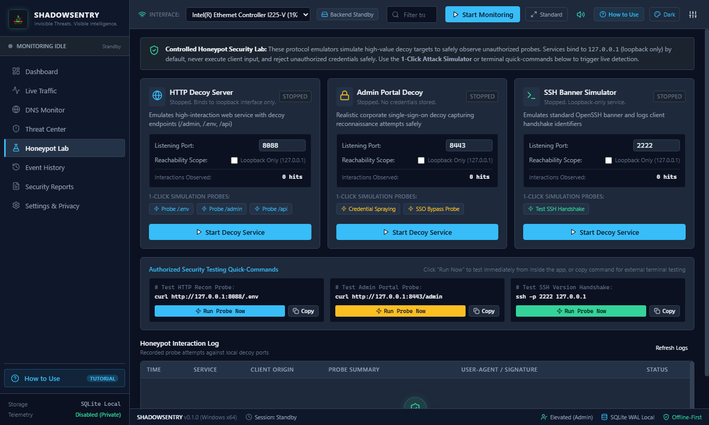
</p>

### 8. Forensic Audit History & Sanitized Export (`Ctrl + 6`)
> Permanent local SQLite database records with multi-attribute search, payload sanitization, and structured JSON / CSV report generation.
<p align="center">
  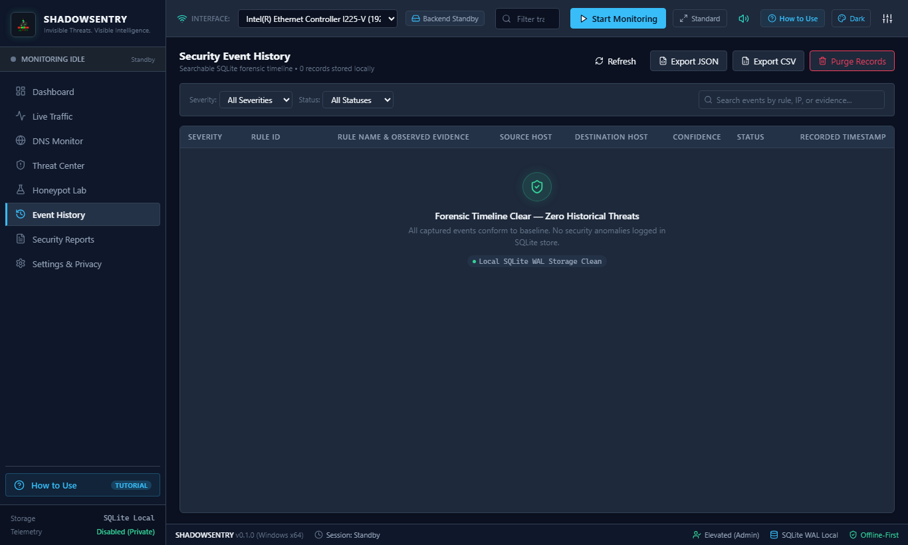
</p>

### 9. Heuristic Thresholds & Zero-Cloud Privacy Controls (`Ctrl + 7`)
> Complete user control over port scan thresholds, Shannon entropy cutoffs, ring buffer memory ceilings, and database retention policies.
<p align="center">
  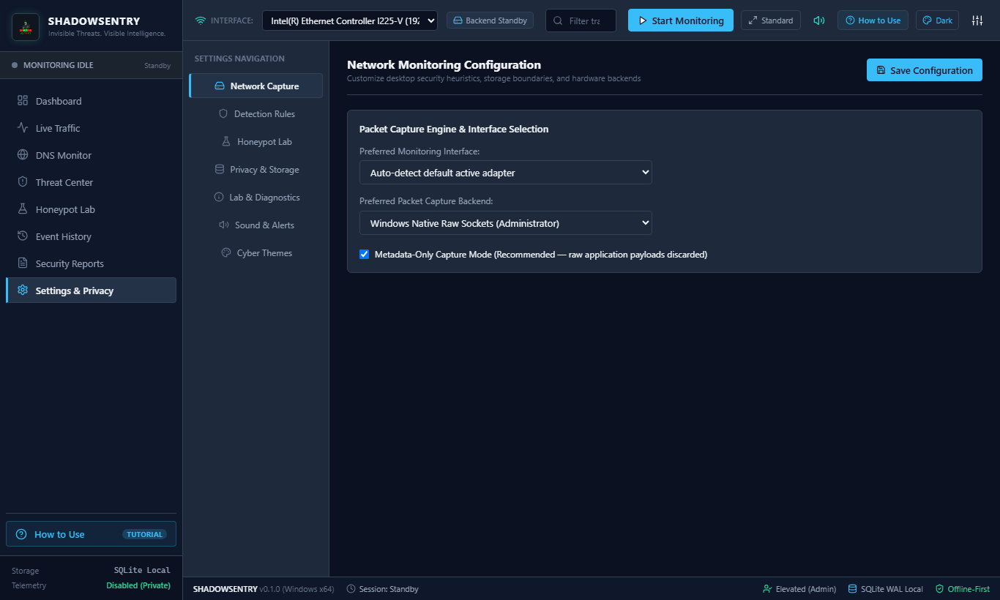
</p>

---

## 🧪 Automated Test Suite & Verification

SHADOWSENTRY includes a standalone verification test runner and Python packet fixture generator to guarantee reliability:

### 1. Run Automated Rust Verification Suite (14 Tests)
```powershell
cd src-tauri
cargo run --bin test_runner
cd ..
```
*Executes all 14 unit and integration tests covering parser safety, Shannon entropy calculations, all 10 detection rules, and SQLite CRUD operations:*
```
Running 14 security engine verification tests...
✓ test_packet_parser_safety ... ok
✓ test_dns_question_parser ... ok
✓ test_shannon_entropy_calculation ... ok
✓ test_rule_01_port_scan ... ok
✓ test_rule_02_connection_burst ... ok
✓ test_rule_03_connection_failures ... ok
✓ test_rule_04_suspicious_dns ... ok
✓ test_rule_05_gateway_mac_change ... ok
✓ test_rule_06_arp_conflict ... ok
✓ test_rule_07_threat_intel_match ... ok
✓ test_rule_08_honeypot_interaction ... ok
✓ test_rule_09_inbound_anomaly ... ok
✓ test_rule_10_config_change ... ok
✓ test_fixture_catalog_verification ... ok
Test result: 14 passed; 0 failed.
```

### 2. Generate Test Fixtures & Honeypot Probes
```powershell
# Generate all detection cases and honeypot test scenarios:
python tools/generate_test_packets.py

# Send an authorized test reconnaissance probe to the HTTP Decoy (Port 8088):
python tools/generate_test_packets.py --test-http

# Send an authorized test handshake to the SSH Simulator (Port 2222):
python tools/generate_test_packets.py --test-ssh
```

---

## 🛠️ Build from Source

### Prerequisites
* Windows 10 (64-bit) or Windows 11 (64-bit)
* Node.js v18+ and npm
* Rust 1.75+ (`x86_64-pc-windows-msvc` target)
* Microsoft Edge WebView2 (Pre-installed on Windows 10/11)
* WiX Toolset v3.11+ *(Optional, for building `.msi` installers)*

### Build Pipeline Commands
```powershell
# 1. Install frontend dependencies
npm install

# 2. Compile frontend production bundle (HTML/CSS/TS)
npm run build

# 3. Compile native Rust desktop application
cargo build --manifest-path src-tauri/Cargo.toml

# 4. Copy fresh executable to project root
Copy-Item "src-tauri/target/debug/shadowsentry.exe" "ShadowSentry.exe" -Force

# 5. Build standalone Windows MSI installer package
npx tauri build --debug --no-sign --bundles msi
```

---

## 🔍 Forensic Honesty & Privacy Model

SHADOWSENTRY is engineered with uncompromising privacy and forensic transparency:

1. **Zero External Dependencies / Telemetry:**
   All packet parsing, threat analysis, and forensic logging occur strictly in-memory and inside local SQLite databases on your machine. No telemetry or crash dumps are ever transmitted externally.
2. **Payload Protection:**
   Application layer payloads are truncated and stripped by default. Only network headers (Layer 2-4) and DNS query labels are parsed and stored.
3. **Switched Network Realities:**
   On switched Ethernet or isolated Wi-Fi networks, a standard network adapter captures traffic directed to its own MAC address, alongside broadcast and multicast packets. Promiscuous capture of third-party unicast packets requires port mirroring (SPAN) or a network tap.
4. **Encrypted Protocols (DoH / DoT):**
   DNS-over-HTTPS (DoH) and DNS-over-TLS (DoT) encrypt queries within TLS 1.3 tunnels. SHADOWSENTRY monitors connection endpoints but does not perform intrusive man-in-the-middle TLS decryption.

---

## 📚 Documentation Directory

| Document | Description |
| :--- | :--- |
| **[`HOW_TO_RUN.md`](file:///d:/projects%20and%20certificates/projects/apps/Shadow%20Sentry/HOW_TO_RUN.md)** | **Primary Execution Manual:** Standalone `.exe` launch, Administrator elevation, and mode selection. |
| **[`PACKAGES_NEEDED.md`](file:///d:/projects%20and%20certificates/projects/apps/Shadow%20Sentry/PACKAGES_NEEDED.md)** | **Dependency Catalog:** Complete list of system runtimes, npm packages, and Rust crates with logos. |
| **[`docs/architecture.md`](file:///d:/projects%20and%20certificates/projects/apps/Shadow%20Sentry/docs/architecture.md)** | Four-tier architectural specification, security boundaries, and IPC contract. |
| **[`docs/threat-model.md`](file:///d:/projects%20and%20certificates/projects/apps/Shadow%20Sentry/docs/threat-model.md)** | Formal threat modeling, trust boundaries, attack surface analysis, and mitigations. |
| **[`docs/windows-requirements.md`](file:///d:/projects%20and%20certificates/projects/apps/Shadow%20Sentry/docs/windows-requirements.md)** | Windows OS integration, elevation privileges, WinSock 2 raw sockets, and Npcap driver details. |
| **[`docs/capture-limitations.md`](file:///d:/projects%20and%20certificates/projects/apps/Shadow%20Sentry/docs/capture-limitations.md)** | Forensic honesty on switched subnets, Wi-Fi isolation, and encrypted DNS protocols. |
| **[`docs/privacy-design.md`](file:///d:/projects%20and%20certificates/projects/apps/Shadow%20Sentry/docs/privacy-design.md)** | Local-only SQLite architecture, data retention policies, and sanitization algorithms. |
| **[`docs/testing-guide.md`](file:///d:/projects%20and%20certificates/projects/apps/Shadow%20Sentry/docs/testing-guide.md)** | Security test suite guide, fixture verification, and synthetic attack simulation. |
| **[`docs/honeypot-lab.md`](file:///d:/projects%20and%20certificates/projects/apps/Shadow%20Sentry/docs/honeypot-lab.md)** | Honeypot deception services, loopback containment, and anti-pivoting defenses. |
| **[`PRIVACY.md`](file:///d:/projects%20and%20certificates/projects/apps/Shadow%20Sentry/PRIVACY.md)** | Privacy commitment, local data retention, and zero-telemetry guarantee. |
| **[`SECURITY.md`](file:///d:/projects%20and%20certificates/projects/apps/Shadow%20Sentry/SECURITY.md)** | Vulnerability disclosure policy, local security controls, and reporting guidelines. |

---

## ⚖️ License

SHADOWSENTRY is open-source software licensed under the [MIT License](LICENSE).
